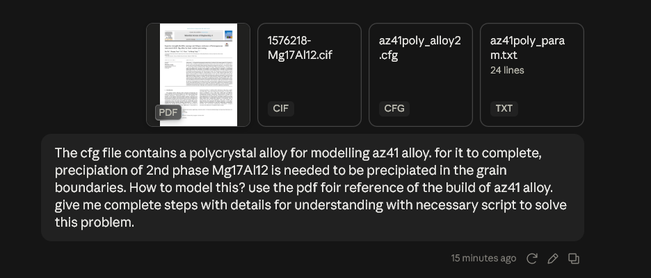

# Building The  Polycrystal

First created simulation box for 350K atoms.

[param.txt.txt](http://param.txt.txt)

Then ran command—

```py
 	atomsk --polycrystal "9012001-Mghcp.lmp" param.txt.txt az41poly.lmp lmp cfg -wrap
```

This generated— `az41poly.lmp` and `az41poly.cfg` files.

`az41poly.lmp` contains 349469 atoms.

Al needed= 349469 \* .037358

Zn needed= 349469 \* .004280

Command ran—

```py
atomsk az41poly.cfg -select random 13055 Mg -substitute Mg Al -select random 1496 Mg -substitute Mg Zn az41poly_alloy2 lmp cfg
```

This gave `az41poly_alloy2.cfg` file

<aside>
⚠️

&nbsp;

Problem found. `az41poly_alloy2.lmp` is not being replaced with Al and Zn.

Solved that by converting `az41poly_alloy2.cfg`  to lmp data file in ovito.

</aside>

&nbsp;

After this ran the following command in claude.



Thread link: [https\://claude.ai/share/4e9ad5af-7aa7-43e0-adb9-63f21f0a20fa](https://claude.ai/share/4e9ad5af-7aa7-43e0-adb9-63f21f0a20fa)

Please check the `Readme.md`  file for details. `Az41poly with precipitates.cfg` contains the final structure.